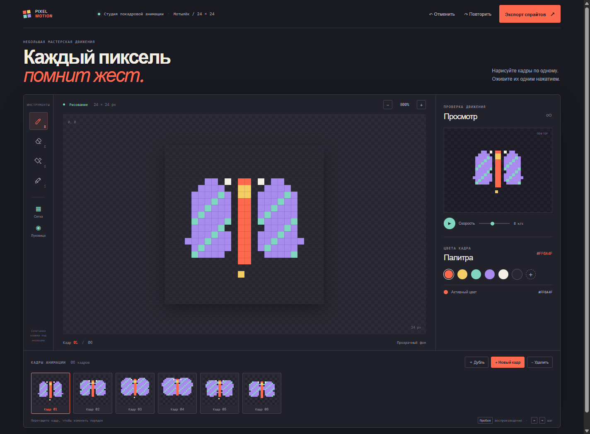

# Pixel Motion Studio

**Draw a little. Move a lot.** Pixel Motion Studio is a small frame-by-frame sprite workshop. Sketch on the enlarged pixel grid, arrange frames in a timeline, and watch the motion loop in the preview.

## Русский

Pixel Motion Studio — редактор покадровой пиксельной анимации в браузере. В проекте есть короткая анимация мотылька: её можно менять или взять за основу своего спрайта.

### Возможности

- Холст от 8 × 8 до 128 × 128 пикселей: карандаш, ластик, заливка и пипетка. При расширении рисунок остаётся по центру; уменьшение аккуратно подгоняет его под новый холст.
- Луковичная калька показывает предыдущий кадр при рисовании следующего.
- Кадры можно добавлять, дублировать, удалять и менять местами перетаскиванием.
- Просмотр анимации с частотой от 2 до 16 кадров в секунду.
- Сетка пикселей, масштаб холста, готовая палитра и выбор своего цвета.
- Отмена и возврат действия, сочетания клавиш, PNG-спрайт-лист, парный JSON-манифест с координатами кадров, таймингом, циклом и точкой опоры, а также GIF с прозрачностью и выбранной частотой.
- GIF кодируется прямо в браузере, без загрузки кадров на сервер и без сторонней библиотеки.

### Запуск

Откройте `index.html` или запустите локальный статический сервер из этой папки.

## English

Pixel Motion Studio is a browser-based, frame-by-frame pixel animation editor. It comes with a small moth loop you can edit or use as a starting point for your own sprite.

### Features

- Canvas sizes from 8 × 8 to 128 × 128 pixels, with pencil, eraser, flood fill, and eyedropper tools. Expanding keeps the sprite centered; shrinking fits it to the new canvas.
- Onion skinning shows the previous frame while drawing the next one.
- Add, duplicate, delete, and drag frames to reorder them.
- Preview the animation at 2–16 frames per second.
- Pixel grid, canvas zoom, a ready-made palette, and a custom color picker.
- Undo and redo, keyboard shortcuts, PNG sprite-sheet export, a matching JSON frame manifest with atlas rectangles, timing, loop and origin, and animated GIF export with transparency and the selected playback speed.
- GIFs are encoded locally in the browser; frames are never uploaded and no third-party library is required.

### Run

Open `index.html` or serve this directory with a local static web server.

## Design idea

Pixel animation belongs to the workshop and the arcade. A deep ink-colored editor keeps the transparent canvas legible, while coral tools, bright palette chips, and a contact-sheet timeline make each frame feel like a printed cel arranged into a loop. The drawing and its timing stay in the foreground.
